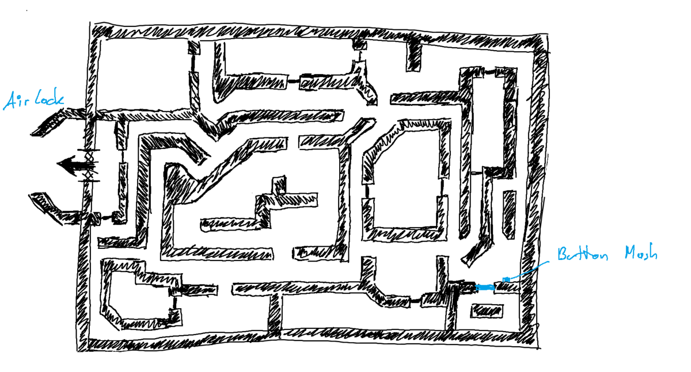

# Tenebris

A two-player co-op puzzle horror game made in Unity. You and a partner are stranded on an abandoned,
dark spaceship while an alien hunts you by sound. Restore the generators, keep the oxygen from running
out, and work together to lure the monster into the airlock and eject it into space.

Built in four weeks by a team of four for the *Game Engineering* course at FH Technikum Wien (2024).

**[Download the Windows build](https://github.com/JohannesHenz/Tenebris/releases/latest)**

## Gameplay

- **Local co-op on one screen:** two players share a dynamic camera, each with a controller or keyboard
- **Darkness:** limited visibility, flickering lights and a cold, metallic look keep you on edge
- **A monster that hunts by sound:** its AI switches between *roaming*, *checking out* noises and *chasing*
  players in hearing range. Footsteps and repairs make noise that can give you away
- **Distraction as a tool:** make a loud noise on purpose to lure the monster away from your partner
- **Oxygen as a timer:** the monster tears air leaks into the hull, which drain the oxygen faster until
  someone fixes them with a wrench; broken windows are patched with duct tape
- **Objectives:** collect gears to repair the generators, open powered doors, revive a fallen partner at the
  med station, and trigger the airlock with the monster inside to win

| Action     | Controller     | Keyboard |
|------------|----------------|----------|
| Join game  | Start          | Space    |
| Move       | Left stick     | WASD     |
| Interact   | Right shoulder | E        |
| Make noise | Left shoulder  | Q        |

## Design

The level started as a hand-drawn sketch of the ship, with the airlock on the left and a co-op button
puzzle on the right. The full concept, mechanics and balancing notes are in the
[Game Design Document](Game%20Design%20Document.pdf).

## Architecture

The gameplay code in [`GameEngineeringProject/Assets/Scripts`](GameEngineeringProject/Assets/Scripts) is
built from small, composable components:

- **Interaction system:** players carry an `Interacter`; anything usable implements `IInteractable`
  (pickups, dispensers, conditioned interactables that need an item, reviving another player)
- **CallActions:** a lightweight event system that lets level designers wire triggers to effects in the
  editor, e.g. a button opening a door, a relay firing several actions, a delay, a light or particle change
- **Noise system:** footsteps, tasks and deliberate noise emit typed sounds through a `SoundManager`;
  expanding sound waves visualize them and alert the monster within hearing range
- **Monster AI:** a NavMesh agent with roam, checkout and chase states and waypoint patrols; it speeds up
  when it hears a noise and gives up a chase once players get out of range
- **Local multiplayer:** Unity's Input System `PlayerInputManager` handles joining and spawning players with
  their own devices

## My contributions

I worked on the player side of the game and the noise mechanic:

- Player movement, local multiplayer joining and spawning (`PlayerMovement`, `PlayerJoinManager`,
  `PlayerSpawner`)
- Player interaction and the item dispenser (`PlayerInteraction`, `Interactable_Dispenser`)
- The noise system with visible sound waves that the monster reacts to (`SoundManager`, `SoundWaveExpansion`,
  `Wave`, `SoundParticle`)
- Death detection and the monster's flickering presence effect (`DeathChecker`, `MonsterFlicker`)

My teammates built the interaction framework, the CallAction system and the lighting (Laurin), and the
monster AI, oxygen timer and menus (Nino). The full commit history shows each person's work.

## Running it

**Play:** download the Windows build from the [releases](https://github.com/JohannesHenz/Tenebris/releases),
unzip it and start `Tenebris.exe`. Connect up to two controllers, or use the keyboard.

**Open in Unity:**

1. Install **Unity 2022.3.20f1** (LTS) through Unity Hub.
2. Add the `GameEngineeringProject` folder with **Add → Add project from disk**.
3. Open `Assets/Scenes/TitleScreen.unity` and press **Play**.

Scenes: `TitleScreen` → `MainScene` → `WinScreen` / `DeathScreen`.

## Team

[LaurinGob](https://github.com/LaurinGob), Nino, TrixiM and [JohannesHenz](https://github.com/JohannesHenz),
FH Technikum Wien. Published with the team's permission.
Music and sound effects are from open sources.
